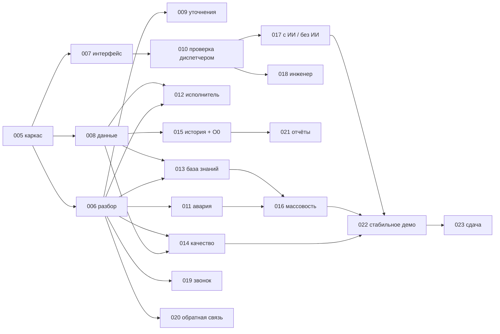

# План: ядро кейса 9 параллельными потоками

Статус: active
Дата: 2026-11-14
Ветка: docs/hackathon-kickoff
PR: —
Коммиты: —
Связано: [../specs/case9-core.md](../specs/case9-core.md), [../hackathon/case9-brief.md](../hackathon/case9-brief.md), [../hackathon/winning-strategy.md](../hackathon/winning-strategy.md#работа-параллельными-агентами), [../tasks/README.md](../tasks/README.md)

SHA коммита ставит Семён у каждого выполненного шага.

## Правила потоков

1. Поток работает **только в своих папках** (колонка «Папки»). Общие файлы (`packages/contracts`, `packages/core`,
   `packages/ui`, корневые конфиги) после потока 0 меняет только отдельная задача «правка контракта», одна за раз.
2. Каждая задача — своя ветка `feature/<кратко>` и маленький PR. Владелец сливает часто.
3. Сначала работает на заглушке модели (`AI_MODE=stub`), потом на облаке.
4. Модуль сырой → `enabledByDefault: false`. В `main` всегда рабочее демо.

## Этап 1. До чекпоинта 1 (2 часа) — «текст → заявка»

Цель: менторы видят, как обращение в чате превращается в заявку с полями, цитатами и приоритетом, плюс схему
архитектуры и план. Некрасиво — можно; не работает — нельзя.

| Время | Поток | Задача | Папки | Итог |
|---|---|---|---|---|
| 0:00–0:35 | **0. Каркас** (один агент, блокирует всех) | 005 | корень, `apps/*`, `packages/*`, `modules/registry.*.ts`, `modules/_example/` | Монорепо, Compose, контракты, ядро с пустыми реестрами, порты с заглушками, тест-контракт. Сквозной срез: `POST /api/appeals` → заглушка → заявка в базе. Проверка API Polza |
| 0:35–1:40 | **А. Разбор** | 006 | `modules/extraction/`, `modules/priority/`, `packages/adapters/src/llm/` | Извлечение полей с цитатами, проверка цитат и справочников, приоритет по матрице. Сначала заглушка, затем Polza |
| 0:35–1:40 | **Б. Интерфейс** | 007 | `packages/ui/`, `apps/web/`, `modules/clarify-chat/web/`, `modules/dispatcher-review/web/` | Токены и оболочка, вход выбором пользователя, чат заявителя с анимацией разбора, карточка заявки (поля, уверенность, цитаты). На моковом API (MSW), затем на настоящем |
| 0:35–1:40 | **В. Данные** | 008 | `data/`, `testset/`, `packages/db/src/seed/` | Справочники, реестр полей, матрица приоритета, CMDB, специалисты, 10 обращений с эталоном и ответами заглушки |
| 1:40–2:00 | Сборка (владелец + агент потока А) | — | — | Слить PR, `docker compose up`, прогнать пример заказчика и ещё 2 обращения, починить стыки |

Что показываем на чекпоинте 1: живой разбор примера заказчика; карточку заявки; схему архитектуры из
спецификации; список «сделано / дальше»; цифру стоимости одного обращения.

Риск этапа: поток 0 не уложился в 35 минут. Тогда потоки Б и В всё равно стартуют (им хватает
`packages/contracts`), поток А ждёт ядро.

## Этап 2. После чекпоинта 1 — обязательные функции как модули

Порядок = приоритет по критериям кейса. Потоки сохраняются; задача берётся, когда освободился поток.

| № | Задача | Поток | Папки | Закрывает |
|---|---|---|---|---|
| 009 | Уточнения в чате: вопросы-карточки, ответы, повторный разбор, «ответа нет → диспетчеру» | А | `modules/clarify-chat/server/` (+ web вместе с Б) | Ментор п. 2–3, демо «нехватка данных» |
| 010 | Проверка диспетчером: очередь, правка поля, подтверждение Enter, журнал «ИИ → человек» | Б | `modules/dispatcher-review/` | К3 |
| 011 | Авария (правила + модель) + уведомление дежурному + красный режим | А | `modules/emergency/` | Демо «авария», ментор п. 5, 9 |
| 012 | Исполнитель: топ-3 с объяснением | В | `modules/routing/` | К2, функция 05 |
| 013 | База знаний: эмбеддинги, статьи и похожие заявки; 40 статей | В | `modules/knowledge/`, `data/kb/` | Функция 07, помощь инженеру |
| 014 | Оценщик и экран «Качество» | В | `modules/quality/`, `testset/` | К1, К2 |
| 015 | История заявок за 6 месяцев (генератор) + дашборд О0 | Г (новый поток) | `modules/history-seed/`, `modules/reports-dashboard/` | Отчётность |
| 016 | Массовость: склейка в инцидент + демо-всплеск | А | `modules/mass-incident/` | Ментор п. 5, «вау» |
| 017 | Замер «с ИИ / без ИИ» | Б | `modules/ai-vs-manual/` | К4 |
| 018 | Рабочее место инженера + замыкание цикла (результат → подтверждение заявителя) | Б | `modules/engineer-desk/` | Слайд 8 заказчика |
| 019 | Звонок: аудио / микрофон → текст → тот же пайплайн | А | `modules/voice-call/`, `packages/adapters/src/speech/` | Функция 02, живая диктовка жюри |
| 020 | Обратная связь заявителю + тональность (метка) | А | `modules/applicant-feedback/`, `modules/sentiment/` | Ментор п. 10, функция 08 |
| 021 | Отчёты О2 «горячие точки», О1 «сводка смены», О5 «эффект ИИ» | Г | `modules/report-hotspots/`, `modules/report-shift/`, `modules/report-ai-effect/` | Отчётность, «вау»-отчёт |
| 022 | Стабильное демо: кэш ответов, `cache-only`, `demo:reset`, сценарий, запасная копия на сервере | В | `data/ai-cache/`, `scripts/`, README | К5, качество и работоспособность |
| 023 | Сдача: README (запуск, архитектура), отчёт о качестве и ограничениях, план внедрения, SonarQube без замечаний | Г | `README.md`, `docs/`, `reports/` | Чек-лист сдачи, оценка кода |

**Чекпоинт 2 — примерно 15 ноября, 18:00 по Сургуту** (владелец 2026-11-14 в ~15:00: «27 часов и 3 минуты до второго
чекпоинта»; ❓ точное время подтвердить). Времени больше, чем ждали, поэтому к чекпоинту 2 готово **всё 009–023**:

| Срок (от чекпоинта 1) | Что готово |
|---|---|
| +4 ч | 009–013: три случая демо (типовое, нехватка данных, авария) работают целиком |
| +8 ч | 014–018: качество, история и дашборд, массовость, «с ИИ / без ИИ», цикл инженера |
| +12 ч | 019–021: звонок, обратная связь, отчёты с выводами |
| +16 ч | Фичи из брейншторма (через feature-intake), «вау»-визуал |
| за 6 ч до чекпоинта 2 | 022–023: стабильное демо, сдача, SonarQube; дальше только исправления и репетиция |

Расширения (скриншот, порог ползунком, карта объектов, прогноз, Telegram и всё из брейншторма) — только через
[../prompts/feature-intake.md](../prompts/feature-intake.md), после 014 и не в ущерб 015–023.

## Зависимости

## Что нужно от владельца

- ✅ Задачи 005–023 созданы (2026-11-14). Запустить агента на 005, после его слияния — три агента на 006, 007, 008.
- Ключ Polza в `.env` на ноутбуке (в репозиторий не кладётся).
- ❓ Время защиты и сдачи материалов на платформе (чекпоинт 2 известен — см. этап 2).
