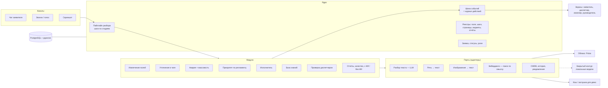
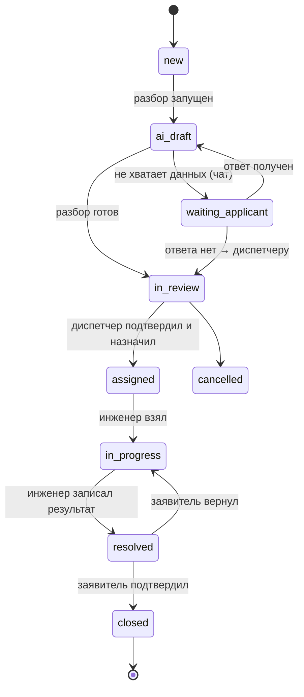

# Спецификация ядра: кейс 9 «Диспетчерская с ИИ»

Статус: active
Дата: 2026-11-14
Ветка: docs/hackathon-kickoff
PR: —
Коммиты: —
Связано: [../hackathon/case9-brief.md](../hackathon/case9-brief.md), [../hackathon/criteria.md](../hackathon/criteria.md), [../hackathon/mentor-notes.md](../hackathon/mentor-notes.md), [../plans/case9-core.md](../plans/case9-core.md), [feature-template.md](feature-template.md), [../tasks/004-core-contract.md](../history/2026-11.md), [../sessions/2026-11-14-architecture.md](../sessions/2026-11-14-architecture.md)

Закрывает: критерии кейса К1–К5 ([criteria.md](../hackathon/criteria.md#кейс-9-диспетчерская-с-ии-газпром-трансгаз-сургут---выбран-2026-11-14)),
«Технологичность» и «Качество и работоспособность» экспертов, оценку кода (SonarQube).

> ⚠️ **Разбор обращения — агент с инструментами, не RAG; качество — через проверки:** [case9-agent-harness.md](case9-agent-harness.md). Он важнее этого файла.

> ⚠️ **Обновлено после брейншторма (2026-11-14): [case9-features.md](case9-features.md).** Где документы расходятся,
> прав он. Кратко: вопросы заявителю составляет модель; лимита вопросов нет; режимы ИИ — только `cloud` и `stub`
> (без кэша, офлайн-режима, запасных путей и повторов); тональности нет; приоритетов 5 (с «Аварией»); есть гость.

> Главная идея: **маленькое ядро + модули**. Ядро умеет только запускать шаги разбора, публиковать события,
> хранить заявку и держать реестры. Всё предметное (извлечение, авария, исполнитель, отчёты, экраны) — модули.
> Новая фича = новая папка в `modules/` + одна строка регистрации.

## 0. Решения владельца (2026-11-14, эта сессия)

| Вопрос | Решение |
|---|---|
| Первый чекпоинт менторов | Через ~2 часа после начала сессии. К нему — сквозной путь «текст → заявка» |
| Модель ИИ | Только облако (Polza). **Локальные модели не разворачиваем.** Закрытый контур — порт в архитектуре + слайд «как это ставится локально» (ментор это допускал) |
| Выбор модели | Дешёвая и подходящая: см. раздел 5.4. Окончательный выбор — по цифрам оценщика на тестовом наборе |
| Вход в систему | Выбор готового пользователя из сид-данных, без регистрации. Права — на сервере |
| Что уходит заявителю без диспетчера | Только шаблонные сообщения: вопросы-карточки и «заявка принята». Свободный текст ИИ — после подтверждения |

## 1. Архитектура

Модульный монолит: один сервер, одно веб-приложение, одна база. Без микросервисов и очередей.



Эта же схема идёт на слайд «Архитектура»: несколько ИИ-моделей (P1–P4), адаптеры, закрытый контур пунктиром.

### 1.1 Стек

| Слой | Выбрали | Потому что | Отвергли |
|---|---|---|---|
| Монорепо | pnpm workspaces, Node.js 22, TypeScript `strict` | Просто, без лишних инструментов | Nx/Turborepo — настройка дороже пользы |
| Контракты | zod | Из одной схемы: типы TS, JSON Schema для модели, проверка API | Ручные типы + JSON Schema — расходятся |
| Сервер | Fastify + `fastify-type-provider-zod`, SSE | Проверка входа и выхода по схемам контрактов из коробки | NestJS — много шаблонного кода, дольше |
| База | PostgreSQL 16 + pgvector, Drizzle ORM | Схема таблиц на TS, векторы без костылей | Prisma — pgvector через сырые запросы, генерация кода |
| Веб | React + Vite, TanStack Query, React Router, Tailwind, Framer Motion, ECharts | SPA без серверного рендера, быстрая сборка, моковый API через MSW | Next.js — SSR не нужен, а сервер уже есть |
| ИИ | Пакет `openai` с адресом Polza (API совместим с OpenAI Chat Completions) | Один клиент для текста, картинок, эмбеддингов | Свой HTTP-клиент |
| Тесты и качество | Vitest (+ покрытие lcov), ESLint, Prettier, SonarQube в Docker | Требование [code-quality](../rules/code-quality.md) | — |
| Запуск | Docker Compose: `db`, `api`, `web` (+ профиль `sonar`) | Одна команда | — |

### 1.2 Слои и направление зависимостей

```
apps (api, web) → modules → adapters, db → core → contracts
```

- Стрелка = «может импортировать». Обратно — нельзя (проверяет ESLint-правило границ).
- **Модули не импортируют друг друга.** Общаются через события и через данные разбора (раздел 3.2).
- Веб-часть импортирует только `contracts`, `ui` и веб-части модулей. Серверный код в браузер не попадает.

## 2. Структура репозитория

```
apps/
  api/                 сервер: сборка ядра и модулей, HTTP, SSE
  web/                 веб-приложение: оболочка, маршруты, вход
packages/
  contracts/           ★ zod-схемы: домен, ответ ИИ, API, события
  core/                ★ ядро: движок пайплайна, шина событий, реестры, интерфейсы портов, defineModule, флаги
  adapters/            реализации портов: polza, stub, cache, уведомления
  db/                  таблицы ядра (Drizzle), миграции, репозитории
  ui/                  ★ дизайн-токены, общие компоненты, счётчик действий
  testkit/             тест-контракт модулей, фабрики тестовых данных
modules/
  registry.server.ts   ★ манифест серверных частей модулей (одна строка на модуль)
  registry.web.ts      ★ манифест веб-частей модулей (одна строка на модуль)
  <id>/                одна фича = одна папка (раздел 3.7)
data/                  справочники, реестр базовых полей, регламент, CMDB, специалисты, база знаний (JSON)
testset/               10 обращений + эталон (К1)
prompts/               общие куски промптов (промпты модулей лежат в модулях)
docker-compose.yml, README.md, sonar-project.properties
```

**Общие файлы (★)** — их меняет только отдельная маленькая задача «правка контракта/ядра», одна за раз:
`packages/contracts`, `packages/core`, `packages/ui` (токены), корневые конфиги.
Манифесты `registry.*.ts` — исключение: каждый агент дописывает **одну свою строку** в алфавитном порядке
(конфликт слияния тривиален). Всё остальное агент делает только в папке своего модуля.

## 3. Точки расширения

### 3.1 Контракты — единый источник

Лежат в `packages/contracts/src/`: `domain.ts`, `ai.ts`, `api.ts`, `events.ts`, `fields.ts`.

```ts
export const FieldValue = z.object({
  key: z.string(),
  value: z.union([z.string(), z.number()]).nullable(),
  confidence: z.number().min(0).max(1),
  quote: z.object({ sourceId: z.string(), text: z.string() }).nullable(),
  origin: z.enum(['text', 'asked', 'cmdb', 'rule', 'human', 'none']),
  needsReview: z.boolean(),
  trace: z.array(TraceEntry),            // цепочка «нашёл → спросил → диспетчеру»
});
export type FieldValue = z.infer<typeof FieldValue>;
```

- Типы TS — `z.infer`. JSON Schema для модели — `z.toJSONSchema()`. API проверяет вход и выход этими же схемами.
- Веб получает типы из того же пакета. Поменял схему — компилятор показывает все места.
- Модуль держит **свои** схемы у себя (`modules/<id>/contracts.ts`) и не правит общий пакет.

### 3.2 Пайплайн разбора — шаги по стадиям

```ts
export type Stage = 'intake' | 'enrich' | 'extract' | 'validate' | 'assess' | 'route' | 'knowledge' | 'respond' | 'finalize';

export interface PipelineStep {
  id: string;                         // 'emergency.detect'
  title: string;                      // текст для анимации разбора
  stage: Stage;
  order?: number;                     // порядок внутри стадии, по умолчанию 100
  reads: DraftKey[];                  // что читает из черновика
  writes: DraftKey[];                 // что пишет
  timeoutMs?: number;
  run(ctx: StepContext): Promise<DraftPatch>;
  fallback?(ctx: StepContext, error: unknown): Promise<DraftPatch>;  // запасной путь
  evaluate?(expected: ExpectedCase, draft: AnalysisDraft): Metric[]; // для оценщика (3.10)
}

export interface StepContext {
  runId: string;
  appeal: Appeal;                     // оригинал обращения, не меняется
  draft: Readonly<AnalysisDraft>;
  ports: Ports;                       // раздел 3.4
  data: ReferenceData;                // справочники, реестр полей, регламент, настройки
  progress(p: StepProgress): void;    // уходит в интерфейс по SSE
  trace(e: TraceEntry): void;         // след «откуда взято»
  signal: AbortSignal;
}

export interface AnalysisDraft {
  sources: SourceFragment[];          // текст, расшифровка звонка, текст со скриншота
  fields: Record<string, FieldValue>;
  missing: MissingField[];
  emergency?: EmergencyVerdict;
  incident?: IncidentLink;
  priority?: PriorityVerdict;
  assignees?: AssigneeCandidate[];
  knowledge?: KnowledgeHit[];
  replyDraft?: ReplyDraft;
  ext: Record<string, unknown>;       // данные модулей: ключ = id модуля, схема — в модуле
}
```

Правила движка (`packages/core/src/pipeline/`):

- Порядок: по стадиям, внутри стадии — по `order`. Шаги одной стадии, не зависящие друг от друга по `reads/writes`, идут параллельно.
- Конфиг `data/pipeline.json` (необязателен) может выключить шаг или поменять порядок без правки кода.
- Ошибка или таймаут шага → `fallback`, если есть; иначе шаг помечается «не выполнен», разбор **идёт дальше**. Демо не падает.
- Каждый запуск и каждый шаг сохраняются (`pipeline_run`, `pipeline_step`): вход, выход, время, модель. Это и след для диспетчера, и материал для оценщика.
- Повторный запуск с середины: `rerun(runId, fromStage)` — нужен, когда заявитель ответил на вопрос.
- Регистрация шага — в описании модуля (3.7). Ядро про конкретные шаги не знает.

**Аспекты извлечения** — способ добавить анализ **без второго вызова модели**:

```ts
export interface ExtractionAspect<T = unknown> {
  key: string;                        // 'sentiment'
  schema: z.ZodType<T>;               // кусок схемы ответа модели
  promptFile: string;                 // кусок промпта
}
```

Шаг `extraction.fields` собирает один запрос к модели из реестра полей + всех аспектов. Тональность, признаки
аварии «по мнению модели» — это аспекты. Нужна другая модель или другой вход (картинка, звук) — тогда отдельный шаг.

### 3.3 Доменные события = журнал действий

```ts
export interface DomainEvent<T = unknown> {
  id: string; type: string; at: string;
  actor: { kind: 'user' | 'ai' | 'system'; id?: string };
  ticketId?: string;
  payload: T;
}
export interface EventBus {
  publish(event: NewEvent): Promise<void>;                 // запись в event_log, затем рассылка
  subscribe(type: string | '*', handler: EventHandler): void;
}
```

- События ядра (в `contracts/events.ts`): `appeal.created`, `analysis.started`, `analysis.step.completed`,
  `analysis.completed`, `ticket.field.set`, `ticket.field.corrected` (ИИ предложил → человек исправил),
  `ticket.confirmed`, `ticket.assigned`, `ticket.status.changed`, `message.sent`, `setting.changed`.
- События модулей: имя с префиксом модуля (`emergency.detected`, `mass.incident.opened`), схема — в модуле.
- Запись в `event_log` — в той же транзакции, что и изменение. Таблица **только на добавление**
  (триггер базы запрещает UPDATE и DELETE). Журнал действий = чтение этой таблицы.
- Подписчики вызываются после записи; ошибка подписчика не ломает основное действие.
- Тот же поток событий уходит в интерфейс (SSE), с фильтром по роли.

### 3.4 Порты и адаптеры

Интерфейсы — `packages/core/src/ports/`, реализации — `packages/adapters/src/<порт>/`.

```ts
export interface LlmPort {
  structured<T>(req: { promptId: string; vars: Record<string, unknown>; schema: z.ZodType<T>;
                       images?: ImageInput[]; tier?: 'main' | 'cheap' }): Promise<LlmResult<T>>;
}
export interface EmbeddingsPort { embed(texts: string[]): Promise<number[][]>; }
export interface SpeechPort     { transcribe(audio: AudioInput): Promise<Transcript>; }
export interface VisionPort     { describe(image: ImageInput, promptId: string): Promise<VisionResult>; }
export interface CmdbPort       { findEquipment(q: EquipmentQuery): Promise<Equipment[]>; locations(): Promise<LocationNode[]>; }
export interface TicketHistoryPort { similar(embedding: number[], limit: number): Promise<SimilarTicket[]>; }
export interface NotificationPort  { send(n: Notification): Promise<DeliveryResult>; }
export interface ClockPort      { now(): Date; }                    // для демо и тестов массовости
```

| Режим (`AI_MODE`) | Что работает | Когда |
|---|---|---|
| `stub` | Готовые ответы из файлов для тестовых обращений | Разработка, тесты, CI |
| `cloud` | Polza | Обычная работа и демо |

Режим `cache-only` и кэш ответов **отменены** владельцем (2026-11-14). Модель не ответила → шаг «не выполнен»,
заявка уходит диспетчеру с пометкой.

- Локальной реализации **нет** (решение владельца). Она добавляется файлом `adapters/src/llm/local.ts` без правки
  ядра. Индикатора контура в интерфейсе нет (отменён, е9).
- CMDB, история, уведомления — реализации поверх нашей базы («заглушки внешних систем»). Уведомления пишутся
  в таблицу и показываются в интерфейсе (каналы e-mail / Telegram — моковые).

### 3.5 Данные, а не код

Всё лежит в `data/*.json`, проверяется zod-схемой при старте и загружается в базу сид-командой.

| Что | Файл | Кто использует |
|---|---|---|
| Справочники (типы услуг, категории, подразделения, приоритеты) | `data/dictionaries.json` | Схема ответа модели (enum), формы |
| Реестр базовых полей | `data/fields.json` | Промпт, схема, форма, чат, оценщик |
| Матрица приоритета «влияние × срочность», сроки SLA | `data/priority-matrix.json` | Модуль `priority` |
| Регламент аварий: признаки, правила, чек-листы | `data/emergency-rules.json` | Модуль `emergency` |
| Настройки: порог уверенности, окно и порог массовости | `data/settings.json` → таблица `setting` | Меняются в интерфейсе |
| CMDB, специалисты, база знаний | `data/cmdb.json`, `data/engineers.json`, `data/kb/*.json` | Сид |

```ts
export const FieldDef = z.object({
  key: z.string(),                    // 'cabinet'
  label: z.string(),                  // 'Кабинет'
  group: z.enum(['classification', 'location', 'equipment', 'technical', 'symptoms']),
  type: z.enum(['dictionary', 'string', 'number', 'ip', 'text', 'cmdbRef']),
  dictionary: z.string().optional(),  // имя справочника для type = dictionary
  required: z.union([z.boolean(), z.object({ whenCategory: z.array(z.string()) })]),
  extractHint: z.string(),            // подсказка для модели
  pattern: z.string().optional(),     // проверка формата (IP, инвентарный номер)
  ask: z.object({ question: z.string(), widget: z.enum(['buttons', 'select', 'text', 'location']),
                  optionsFrom: z.string().optional() }).optional(),
  evalMode: z.enum(['exact', 'normalized', 'none']),
});
```

Новое поле = запись в реестре (в `data/fields.json` или в поле `fields` своего модуля). Промпт извлечения,
схема ответа, форма диспетчера, карточка-вопрос в чате и строка в отчёте о качестве строятся из реестра сами.

### 3.6 Промпты

- Файлы `modules/<id>/prompts/<имя>.v<N>.md`: шапка (id, версия, модель-уровень) + текст с `{{переменными}}`.
- В коде только `promptId`. Версия промпта входит в ключ кэша и в запись шага — видно, каким промптом получен ответ.
- Текст обращения подставляется в отдельный блок «данные заявителя»; инструкции в нём модель обязана игнорировать.
- Ответ модели → проверка по схеме → не прошёл: шаг «не выполнен», заявка уходит диспетчеру. Повторов и запасных путей нет (решение владельца).
- Температура 0. Значения-справочники заданы в схеме как enum — модель не может вернуть значение вне справочника.

### 3.7 Модули фич

```
modules/<id>/
  server/index.ts      ★ обязательно, если есть серверная часть: export default defineModule({...})
  web/index.ts         ★ обязательно, если есть экраны: export default defineWebModule({...})
  contracts.ts         свои схемы и события (по необходимости)
  server/schema.ts     свои таблицы (по необходимости)
  prompts/, seed/      по необходимости
  tests/               ★ обязательно
  README.md            ★ обязательно: 5 строк — что делает, флаг, точки расширения, момент демо
```

```ts
export function defineModule(m: {
  id: string;
  title: string;
  enabledByDefault: boolean;           // флаг фичи
  fields?: FieldDef[];
  steps?: PipelineStep[];
  aspects?: ExtractionAspect[];
  events?: EventDef[];                 // свои события: имя + схема
  subscribers?: Subscriber[];          // { on: 'ticket.confirmed', handle(event, deps) }
  routes?: (app: ModuleRouter, deps: ModuleDeps) => void;  // под /api/m/<id>/…, у каждого маршрута — право
  reports?: ReportDef[];
  seed?: (deps: SeedDeps) => Promise<void>;
}): ServerModule;
```

- Регистрация: строка `export { default as emergency } from './emergency/server';` в `modules/registry.server.ts`
  и такая же в `modules/registry.web.ts`.
- Флаги: `enabledByDefault` + переопределение `FEATURES_OFF=a,b` / `FEATURES_ON=c` в `.env`. Выключенный модуль
  не регистрирует ничего: шагов нет, маршрутов нет, пункта меню нет. Интерфейс получает список включённых модулей
  из `GET /api/meta`.
- `ModuleDeps` = `{ bus, ports, data, db, tickets, settings, clock }`. Модуль не лезет в чужие таблицы — только
  через сервис `tickets` ядра и события.
- **Приём обращений и заголовки (задача 036, решение владельца 2026-11-14, вариант A).** `ModuleDeps.appeals?.submit(appeal, { actor?, wait? })`
  → `{ appealId, ticketId, ticketNumber, runId }` — тот же путь, что `POST /api/appeals`: обращение, `appeal.created`, черновик заявки,
  пайплайн, итог в заявку. `wait: false` возвращает заявку сразу, разбор идёт в фоне (`runId` фонового прогона уже известен клиенту — по нему идёт SSE) — так звонок не ждёт 20 с.
  Обработчик маршрута модуля получает `headers` (имена в нижнем регистре) — например, `x-forwarded-for` для лимита частоты.
  Оба поля необязательные в типе, чтобы тесты модулей собирали `ModuleDeps` без сервера; сервер приложения передаёт их всегда.

### 3.8 Интерфейс

```ts
export function defineWebModule(m: {
  id: string;
  pages?: PageDef[];        // { path, title, icon, roles, component, nav?: { section, order } }
  widgets?: WidgetDef[];    // { slot, id, order, roles, component }
  chatCards?: ChatCardDef[];// виджеты ответа в чате заявителя: { widget: 'location', component }
  reportViews?: ReportViewDef[];
}): WebModule;
```

Слоты виджетов: `dashboard.tiles`, `dashboard.main`, `ticket.banner`, `ticket.main`, `ticket.side`,
`ticket.footer`, `queue.toolbar`, `applicant.chat.footer`, `shell.topbar`.
Карточка заявки и дашборд — это страницы ядра, которые рисуют виджеты слота по порядку; модуль добавляет свой.

`packages/ui`: дизайн-токены (цвета, отступы, тени, длительности анимаций — CSS-переменные + Tailwind-тема),
компоненты (`Card`, `Badge`, `ConfidenceBar`, `QuoteChip`, `FieldRow`, `StatTile`, `Chart`, `Timeline`,
`EmergencyOverlay`), готовые анимации (`flyToField`, `pulse`, `countUp`), хук `useActionCounter` (для К4).
Модулям запрещены свои цвета и «сырые» значения анимаций — только токены. Так стиль не разъезжается между агентами.

### 3.9 Отчёты

```ts
export interface ReportDef<P = unknown, R = unknown> {
  id: string; title: string; question: string;     // вопрос руководителя
  params: z.ZodType<P>;                            // период, фильтры
  result: z.ZodType<R>;
  compute(params: P, deps: ReportDeps): Promise<R>;          // цифры считает код
  facts?(result: R): Fact[];                                 // { label, value } — только это видит ИИ
  insightPromptId?: string;                                  // «что это значит» + «что сделать»
  drilldown?(result: R, key: string): TicketFilter;          // клик по цифре → список заявок
}
```

- Вывод формулирует модель уровня `cheap` только по `facts`. Проверка: каждое число в тексте вывода есть среди
  фактов; не прошло → шаблонный вывод. Так вывод нельзя «выдумать».
- Ядро даёт общие маршруты `GET /api/reports`, `POST /api/reports/:id/run`, выгрузку в Excel/PDF. Новый отчёт
  О1–О8 = модуль с `reports` (сервер) и `reportViews` (веб).

### 3.10 Оценка качества

- `testset/cases/NN-<имя>.json`: `{ id, channel, text | audioFile, expected: { fields, priority, emergency, assigneeTop3, kbArticle } }`.
- Модуль `quality` гоняет **тот же движок** пайплайна по набору и собирает метрики: базовые (по реестру полей,
  режим сравнения — `evalMode`) + то, что вернули `evaluate()` шагов. Новый шаг попадает в оценку сам, если
  в эталоне есть его ключ.
- Команда `pnpm eval` → `reports/quality.md` (в репозиторий) + запись в `eval_run` для экрана «Качество».
- `pnpm eval --model <имя>` — сравнение моделей; так выбираем дешёвую без потери точности.

### 3.11 Проверка точек расширения на идеях из банка

| Идея | Что создаём | Правим ядро? |
|---|---|---|
| Скриншот ошибки | Модуль `screenshot`: шаг стадии `enrich` (VisionPort → `sources`), виджет загрузки в `applicant.chat.footer` | Нет |
| Telegram-бот | Модуль `telegram`: маршрут-вебхук создаёт обращение через сервис ядра; реализация `NotificationPort` для ответов; вопросы берёт из того же реестра полей | Нет |
| Прогноз нагрузки (О8) | Модуль `report-forecast`: `ReportDef` + `ReportViewDef`, читает историю заявок | Нет |
| Отчёт «пробелы базы знаний» (О6) | Модуль `report-kb-gaps`: подписчик на `analysis.completed` копит «статья не найдена», `ReportDef` | Нет |
| Тональность | Модуль `sentiment`: `ExtractionAspect` + виджет-метка в `ticket.banner`. Приоритет не трогает | Нет |
| Карта объектов | Модуль `site-map`: страница + виджет `dashboard.main`, подписка на события по SSE | Нет |

## 4. Модель данных

Таблицы ядра (`packages/db`). Таблицы модулей — в модулях, с префиксом модуля.

| Таблица | Ключевые поля | Примечание |
|---|---|---|
| `user` | id, full_name, role, department_id, position | Роли: applicant, dispatcher, engineer, manager, admin |
| `appeal` | id, channel, author_id, original_text, attachments, created_at | Оригинал, **не меняется** |
| `appeal_message` | id, appeal_id, direction, kind (text / question_card / answer / system), body, field_key | Чат с заявителем |
| `ticket` | id, number, appeal_id, status, priority, category, department_id, assignee_id, is_emergency, incident_id, sla_due_at, confirmed_by, confirmed_at | Колонки priority… — копия из полей для быстрых отчётов |
| `ticket_field` | ticket_id, field_key, value, confidence, quote, origin, needs_review, trace, ai_value | Одна строка на поле; `ai_value` хранит, что предложил ИИ |
| `pipeline_run`, `pipeline_step` | run_id, ticket_id, mode, step_id, status, input, output, duration_ms, model, prompt_version | След разбора |
| `event_log` | id, type, at, actor_kind, actor_id, ticket_id, payload | Только добавление. Журнал действий |
| `dictionary_item` | dictionary, code, label, parent_code, meta | Справочники |
| `field_def` | key, def (jsonb), module_id | Реестр полей |
| `setting` | key, value, updated_by | Пороги |
| `cmdb_location`, `cmdb_equipment` | корпус → этаж → кабинет; тип, модель, инв. и серийный номер, IP, критичность | «Заглушка CMDB» |
| `engineer_profile`, `engineer_skill`, `duty_shift` | user_id, department, level, навык + уровень, корпуса, смены, дежурство, статус | Для маршрутизации и аварий |
| `kb_article` | id, title, symptoms, steps, solution, category, embedding | База знаний |
| `notification` | id, to_user_id, channel, title, body, ticket_id, read_at | Уведомления |
| `ai_cache` | key, port, response, created_at | Кэш ответов моделей |

История заявок = закрытые заявки в тех же таблицах `ticket` / `ticket_field` + `embedding` текста обращения.

### 4.1 Статусы заявки



Переходы — таблица в `contracts/domain.ts` (`из → в → кто может`). Сервис `tickets.transition()` — единственное
место смены статуса; публикует `ticket.status.changed`. **Из `in_review` в `assigned` — только действием человека.**

### 4.2 Роли и права

| Право | Заявитель | Диспетчер | Инженер | Руководитель | Админ |
|---|---|---|---|---|---|
| Создать обращение, видеть свои заявки, подтвердить выполнение | ✅ | ✅ | ✅ | ✅ | ✅ |
| Очередь, правка полей, подтверждение, назначение | | ✅ | | | ✅ |
| Свои задачи, результат, база знаний | | ✅ | ✅ | | ✅ |
| Отчёты, качество, журнал действий | | чтение журнала заявки | | ✅ | ✅ |
| Настройки (пороги), справочники | | | | порог | ✅ |

Вход: `POST /api/session { userId }` → подписанная cookie. У каждого маршрута объявлено право; проверка —
в общем обработчике сервера. Маршрут без объявленного права не проходит тест-контракт.

## 5. Разбор обращения

### 5.1 Контракт ответа модели (шаг извлечения)

```ts
export const AiExtraction = z.object({
  fields: z.array(z.object({
    key: FieldKeyEnum,                        // enum строится из реестра полей
    value: z.string().nullable(),             // для справочников — код из enum
    quote: z.string().nullable(),             // дословный фрагмент обращения
    confidence: z.number().min(0).max(1),
  })),
  aspects: z.object({                         // собирается из аспектов модулей
    emergency: z.object({ suspected: z.boolean(), signs: z.array(z.object({ sign: EmergencySignEnum, quote: z.string() })), confidence: z.number() }),
    clarify: z.object({ fieldKey: FieldKeyEnum.nullable(), question: z.string().max(160), options: z.array(z.string()).max(5) }),
    summary: z.string().max(200),
  }),
});
```

Итог разбора для интерфейса (`AnalysisResult` в `contracts/api.ts`) = `AnalysisDraft` + список шагов со следом.
В нём есть всё из раздела 12 брифа: поля с уверенностью и цитатами, недостающие поля, признаки аварии,
тональность, вопросы заявителю.

Проверки после модели (код, не модель):

1. Цитаты нет в исходном тексте (сравнение без регистра и лишних пробелов) → значение **отбрасывается**, поле пустое. Защита от выдуманных полей.
2. Значение не из справочника или не подходит под `pattern` → отбрасывается.
3. Оборудование сверяется с CMDB (кабинет + тип + модель / серийный номер). Нашлось одно → добавляем инвентарный номер и IP с `origin: 'cmdb'`. Нашлось несколько → вопрос заявителю.
4. `confidence` ниже порога → `needsReview: true`.

### 5.2 Шаги по порядку

| # | Шаг | Стадия | Модуль | Модель? | Запасной путь |
|---|---|---|---|---|---|
| 1 | `intake.normalize` — собрать `sources`, оригинал не трогать | intake | ядро | нет | — |
| 2 | `voice.transcribe`, `screenshot.read` | enrich | `voice-call`, `screenshot` | речь, зрение | Пометка «не распознано», диспетчеру |
| 3 | `extraction.fields` — поля + классификация + аспекты, один вызов | extract | `extraction` | текст | Правила: регулярные выражения (IP, кабинет, корпус, код ошибки) + словарь категорий, уверенность 0,4 |
| 4 | `extraction.ground` — проверки 1–4 из 5.1, CMDB | validate | `extraction` | нет | — |
| 5 | `clarify.missing` — недостающие обязательные поля → вопросы-карточки | validate | `clarify-chat` | нет | — |
| 6 | `emergency.detect` — правила регламента + мнение модели | assess | `emergency` | нет (аспект) | Только правила |
| 7 | `mass.detect` — похожие обращения за окно времени | assess | `mass-incident` | эмбеддинги | Совпадение категории и корпуса |
| 8 | `priority.compute` — матрица «влияние × срочность» | assess (order 200) | `priority` | нет | — |
| 9 | `routing.recommend` — топ-3 с объяснением | route | `routing` | нет | Правило «категория → подразделение» |
| 10 | `knowledge.search` — статьи и похожие заявки | knowledge | `knowledge` | эмбеддинги | Поиск по словам (Postgres full-text) |
| 11 | `feedback.draft` — ответ заявителю | respond | `applicant-feedback` | текст (cheap) | Шаблон |
| 12 | `finalize` — статус, итоговая уверенность, событие | finalize | ядро | нет | — |

Чек-пойнт 1 требует шаги 1, 3, 4, 8, 12.

### 5.3 Ключевые алгоритмы

**Уточнения в чате** (устарело — актуальный сценарий в [case9-features.md](case9-features.md#31-чат-с-вопросами-по-смыслу-а1-а2-а3)). Шаг 5 находит пустые обязательные поля → модуль `clarify-chat` отправляет вопросы-карточки
из `FieldDef.ask` (шаблон, без подтверждения диспетчера) → заявка в `waiting_applicant`. Ответ пишется в поле с
`origin: 'asked'` и следом «спросили → ответил», затем `rerun(fromStage: 'validate')`. Не больше 2 кругов; «не знаю»
или молчание (таймер, настройка) → след «спросили — ответа нет → диспетчеру», заявка в `in_review`.
После разбора заявитель получает шаблон «Заявка № … принята, приоритет …» автоматически.

**Авария.** Два независимых сигнала: (а) правила из `data/emergency-rules.json` — признак = набор слов и шаблонов
+ условие (например, «дым / гарь / искрит» при любом оборудовании); (б) аспект `emergency` модели.

| Правила | Модель | Итог |
|---|---|---|
| да | да | Авария, высший приоритет, уведомление сразу |
| сработал только один из двух | — | Авария «под вопросом»: приоритет высший, уведомление уходит, диспетчер подтверждает первым делом |
| нет | нет | Обычный путь |

При сомнении — эскалация. Уведомление — дежурному специалисту с нужным навыком (из `duty_shift` + навыки),
то есть «тому, кто может решить». В заявке — чек-лист из регламента. Событие `emergency.detected` → красный режим в интерфейсе.

**Массовость.** Новое обращение сравнивается с обращениями за окно (по умолчанию 15 минут): близость эмбеддингов
≥ порога **или** одна категория + один корпус / одна система. Набралось N (по умолчанию 5) → создаётся инцидент,
заявки привязываются, приоритет инцидента — высший, срабатывает путь аварии. Окно и N — настройки.

**Приоритет.** Модель извлекает **поля** `impact` (один человек / группа / корпус / предприятие) и `urgency`
(работа стоит / есть обход / не срочно) с цитатами. Приоритет считает код по матрице из `data/priority-matrix.json`;
поправки: критичность оборудования из CMDB, массовость, авария (сразу высший). Тональность на входе **не участвует**.
Результат — приоритет + срок SLA + текст «почему»: какое правило сработало.

**Исполнитель.** Оценка каждого инженера = сумма факторов с весами: подразделение по категории, навык и его уровень,
на смене ли, закреплён ли за корпусом, загрузка, решал ли похожее. Весь расчёт — код; объяснение собирается из
факторов («навык „принтеры HP“ — эксперт; на смене; 2 открытые заявки; решил 5 похожих»). Уверенность низкая
(разрыв между 1-м и 2-м мал или нет никого на смене) → выбор за диспетчером.

**База знаний.** Эмбеддинг текста обращения + извлечённых полей → pgvector по `kb_article` и закрытым заявкам →
топ-3 статей и топ-3 заявок со ссылками и шагами. Эмбеддинги статей считаются при сиде и кэшируются.

### 5.4 Модели (Polza)

> **Решение владельца:** одна модель `deepseek/deepseek-v4.1-flash` для разбора и отчётов, эмбеддинги не используются —
> см. [case9-agent-harness.md](case9-agent-harness.md#6-модель). Таблица ниже — справочно, кандидаты для сравнения.

Обновлено 2026-11-14 по открытому каталогу провайдера (`GET https://api.polza.ai/api/v1/models`, 396 моделей).
Цены — ₽ за 1 млн токенов (вход / выход). Отбор: поддержка структурированного ответа, картинки на входе, цена.

| Задача | Переменная | Модель (id в API) | Цена | Почему |
|---|---|---|---|---|
| Разбор обращения, вопросы заявителю, скриншот | `LLM_MODEL_MAIN` | `openai/gpt-6-luna` | 6,08 / 30,42 | Структурированный ответ по схеме, картинки, без обязательного «размышления» (быстро). Одно обращение ≈ 0,05 ₽ |
| Выводы отчётов, ответ заявителю, оформление результата инженера | `LLM_MODEL_CHEAP` | `deepseek/deepseek-v4-flash` | 1,87 / 3,74 | Самая дешёвая со структурированным ответом и картинками. ≈ 0,01 ₽ за вызов |
| Поиск по смыслу | `EMBEDDINGS_MODEL` | `baai/bge-m3` | 0,88 | Многоязычная, вектор 1024 — помещается в индекс pgvector |
| Речь → текст | `SPEECH_MODEL` | `ai-sage/gigaam-v3` | 0,25 ₽ за минуту | Заточена под русскую речь |

Кандидаты на замену `main` (сравнить `pnpm eval --model …`): `deepseek/deepseek-v4.1-flash-1017` (8,67 / 12,87),
`deepseek/deepseek-v4-flash`, `google/gemini-2.5-flash-lite` (6,08 / 24,33). Запасная для речи —
`openai/whisper-large-v3-turbo` (0,05 ₽ за минуту).

- **Claude Haiku 5.5 снят:** в каталоге у него нет строгого структурированного ответа, и он вдвое дороже.
- Адрес API: `https://api.polza.ai/api/v1`; маршруты `/chat/completions`, `/embeddings`, `/audio/transcriptions` —
  по каталогу есть. ❓ Вживую с ключом не проверено (`pnpm check:polza`).
- Качество на русском по каталогу не видно — окончательный выбор `main` по цифрам `pnpm eval` на тестовом наборе.
- Весь хакатон — меньше 100 ₽.
- Если понадобится хранение данных в России (внедрение): `openai/gpt-oss-120b` (4,17 / 8,94, без картинок),
  `google/gemma-3-27b-it` (9,73 / 19,47, с картинками) — размещены в РФ.

## 6. API

Все ответы и входы — схемы из `contracts/api.ts`. Префикс `/api`.

| Метод и путь | Что делает | Право |
|---|---|---|
| `GET /meta` | Включённые модули, реестр полей, справочники, режим ИИ | любой |
| `POST /session`, `GET /session`, `GET /users` | Вход выбором пользователя | любой |
| `POST /appeals` | Создать обращение (текст, канал, вложения) → запускает разбор | заявитель+ |
| `GET /appeals/:id/stream` (SSE) | Ход разбора: `step.started`, `step.progress`, `step.completed`, `run.completed` | автор, диспетчер |
| `POST /appeals/:id/messages` | Сообщение или ответ на вопрос-карточку | автор |
| `GET /tickets`, `GET /tickets/:id` | Очередь с фильтрами; заявка с полями, следом, кандидатами, статьями | по роли |
| `PATCH /tickets/:id/fields/:key` | Исправить поле → `ticket.field.corrected` | диспетчер |
| `POST /tickets/:id/confirm` | Подтвердить и назначить (`assigneeId`) | диспетчер |
| `POST /tickets/:id/transition` | Сменить статус (взял, выполнил, подтвердил, вернул) | по таблице переходов |
| `POST /tickets/:id/reanalyze` | Повторить разбор | диспетчер |
| `GET /tickets/:id/events` | Журнал действий по заявке | диспетчер, руководитель |
| `GET /events/stream` (SSE) | Живые события для экранов (по роли) | любой вошедший |
| `GET /notifications`, `POST /notifications/:id/read` | Уведомления | свой |
| `GET /settings`, `PUT /settings/:key` | Пороги | руководитель, админ |
| `GET /reports`, `POST /reports/:id/run`, `GET /reports/:id/export` | Отчёты | руководитель |
| `/m/<модуль>/…` | Маршруты модулей (знания, качество, замер, звонок…) | объявляет модуль |

## 7. Демо

> Кэш, `cache-only` и запасные пути отменены владельцем. Из этого раздела действуют: флаги фич, `pnpm demo:reset`,
> `ClockPort`, демо-всплеск, потоковый показ шагов.

- `AI_MODE=cloud` с записью в кэш; перед защитой прогоняем сценарий — кэш заполнен. Сбой сети → `cache-only`
  одной переменной, сценарий идёт так же.
- Живое обращение от жюри идёт в облако; сбой → запасной путь по правилам + показ правки диспетчером (К3).
- Флаги фич: сырой модуль выключается через `FEATURES_OFF`, остальное работает (проверяет тест-контракт).
- `pnpm demo:reset` — база в исходное состояние демо за секунды. `ClockPort` позволяет «сжать время» для массовости.
- Генерация всплеска похожих обращений — маршрут модуля `mass-incident` только для демо (право админа).
- Потоковый показ шагов: ожидание модели выглядит как «разбор на глазах».

## 8. Метрики К2 и замер К4

**К2 (модуль `quality`).** По набору: точность категории, типа услуги, подразделения, приоритета; по полям —
доля верных, доля пропущенных, доля **выдуманных**; авария — пропуски и ложные срабатывания; исполнитель — топ-1 и
топ-3; статья — в топ-3; доля ушедших на ручную проверку при пороге; время на обращение. Экран «Качество»:
таблица «эталон / ИИ» с зелёными и красными ячейками. Оговорка о размере набора — в отчёте.

**К4 (модуль `ai-vs-manual`).** `useActionCounter` из `packages/ui` считает клики, ввод в поле, выбор из списка,
переход по полю, поиск в справочнике. Режим «вручную» — пустая форма из того же реестра полей; режим «с ИИ» —
обычная карточка проверки. Сессии замера хранятся в таблице модуля; экран — две колонки и итог «N против M действий,
X против Y секунд». Определение «ручного действия» — в отчёте.

## 9. Синтетические данные

Генерация — **скрипт с фиксированным зерном** (каждый запуск даёт одно и то же), не модель на лету.
Тексты (статьи базы знаний, шаблоны обращений) один раз пишет агент и кладёт в `data/` небольшими JSON.

| Что | Объём | Где |
|---|---|---|
| Справочники, матрица приоритета, регламент аварий | по 1 | `data/` |
| CMDB: 4 корпуса (А, Б, В, производственная площадка), ~200 единиц | 1 | `data/cmdb.json` |
| Специалисты: 14 человек, 5 подразделений, навыки, смены, дежурства | 1 | `data/engineers.json` |
| Заявители, диспетчеры, руководитель | ~30 | `data/users.json` |
| База знаний | 40 статей | `data/kb/` |
| История заявок за 6 месяцев: рабочие часы, пик в понедельник, 3 аварии, «больной» принтер в каб. 312 | ~600 | генератор модуля `history-seed` |
| Тестовый набор | 10 | `testset/cases/` |
| Звонки | 4 аудио | `testset/audio/` (❓ записывает владелец или синтез речи macOS) |

Пример заказчика (корпус Б, каб. 312, принтер HP, красный индикатор) обязан быть в CMDB, базе знаний и наборе.
Сид по модулям: `pnpm seed` вызывает сид ядра, затем `seed()` каждого включённого модуля.

## 10. Тесты и качество кода

- TypeScript `strict`, `noUncheckedIndexedAccess`, без `any`. ESLint (включая границы слоёв) + Prettier. `pnpm check` = типы + линтер + тесты.
- Vitest: логика шагов и сервисов — на заглушках портов; база в тестах — Postgres из Compose (❓ или pglite, решает Семён в 005).
  Цель покрытия серверной логики — от 60 %.
- **Тест-контракт модулей** (`packages/testkit/module-contract.ts`) — идёт по манифесту и для каждого модуля проверяет:
  уникальный `id`; у шагов заданы стадия, `reads/writes`, а `reads` кто-то пишет раньше; события с префиксом модуля
  и схемой; маршруты под `/api/m/<id>/` и с правом; файлы промптов существуют; сид проходит свои схемы; есть README;
  **приложение стартует и проходит разбор примера заказчика с выключенным модулем**.
- SonarQube: профиль `sonar` в Compose + `pnpm sonar`; отчёт покрытия lcov. Нет новых Blocker / Critical / Major.
- CI (GitHub Actions): `pnpm check` + проверка ссылок документации.

## 11. Как добавить фичу

1. **Оформи** мини-спецификацию по [feature-template.md](feature-template.md) (10 минут).
2. **Выбери точку расширения:**

   | Нужно | Точка |
   |---|---|
   | Новое поле заявки | `fields` (реестр) — форма, промпт и чат подхватят сами |
   | Новый анализ текста той же моделью | `aspects` |
   | Новый анализ другой моделью или другим входом | `steps` (стадия `enrich` / `assess`) |
   | Реакция на действие (уведомить, посчитать, запомнить) | `subscribers` |
   | Свои данные и API | `server/schema.ts` + `routes` |
   | Новый экран или блок на карточке / дашборде | `pages` / `widgets` |
   | Новый отчёт | `reports` + `reportViews` |
   | Новая внешняя система или модель | порт уже есть → новая реализация в `packages/adapters` |

3. **Создай** `modules/<id>/` по структуре из 3.7. Скопируй ближайший по смыслу модуль как образец.
4. **Зарегистрируй:** по одной строке в `modules/registry.server.ts` и `modules/registry.web.ts`.
5. **Флаг:** `enabledByDefault: false`, пока фича сырая.
6. **Тесты:** успешный путь и каждая ветка ошибки шагов и подписчиков; тест-контракт пройдёт сам. Есть эталон — добавь `evaluate()`.
7. **Проверь:** `pnpm check`, `FEATURES_OFF=<id> pnpm test` (без модуля всё работает), момент в демо.
8. **Документы:** `modules/<id>/README.md`, строка в `docs/map/features/`.

Если приходится править `packages/core` или `packages/contracts` — стоп: точки расширения не хватает. Это отдельная
задача для Данконии, она идёт первой и одна.

## 12. Открытые вопросы

- ❓ Polza: адрес API, `json_schema`, эмбеддинги, речь — проверяет задача 005 (раздел 5.4).
- ❓ Аудио для звонков: записывает владелец или синтез речи.
- ❓ Время защиты и сдачи. Чекпоинт 2 — примерно 15 ноября, 18:00 по Сургуту (со слов владельца).
- ❓ Адрес сервера для запасной копии демо.
- Порог уверенности 0,75; массовость — 5 обращений за 15 минут. Шкала приоритетов и сроки — из брейншторма
  ([case9-features.md](case9-features.md#33-приоритет-сроки-авария)).
