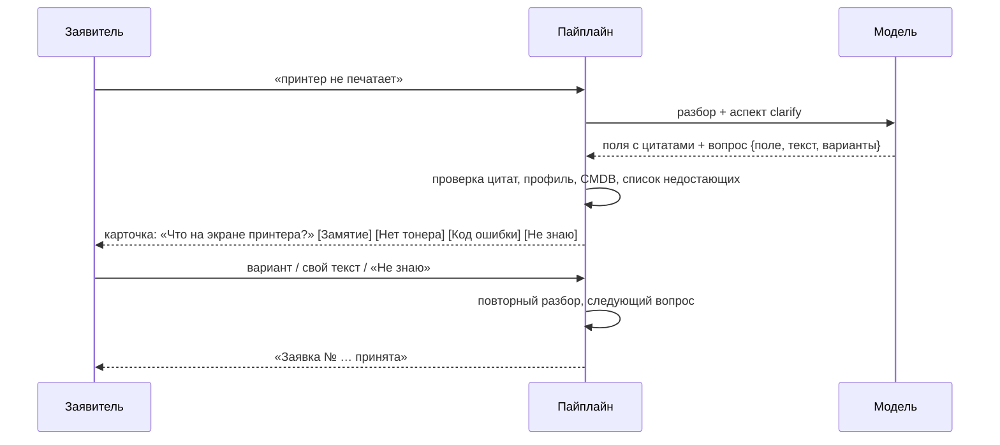

# Спецификация: фичи брейншторма в архитектуре ядра

Статус: active
Дата: 2026-11-14
Ветка: feature/skeleton (документы; ❓ владелец решает, в какой ветке коммитить)
PR: —
Коммиты: —
Связано: [case9-core.md](case9-core.md), [../ideas/case9-brainstorm.md](../ideas/case9-brainstorm.md), [../hackathon/case9-brief.md](../hackathon/case9-brief.md), [../hackathon/criteria.md](../hackathon/criteria.md), [../plans/case9-core.md](../plans/case9-core.md), [../tasks/README.md](../tasks/README.md), [../sessions/2026-11-14-feature-intake.md](../sessions/2026-11-14-feature-intake.md)

Закрывает: критерии кейса К1–К5 и слова ментора ([criteria.md](../hackathon/criteria.md), раздел 1а брифа).

> ⚠️ **Разбор обращения — агент с инструментами, не RAG; качество — через проверки:** [case9-agent-harness.md](case9-agent-harness.md). Он важнее этого файла.

> Этот документ — **дополнение к [case9-core.md](case9-core.md)** после брейншторма. Где они расходятся, прав этот файл.
> Здесь: что изменилось в решениях, одна правка ядра, и для каждой принятой фичи — модуль, точки расширения,
> данные, события, экраны, задача.

## 1. Что изменилось в решениях

| Было в спецификации ядра | Стало | Почему |
|---|---|---|
| Заявителю автоматически уходят только шаблонные вопросы | **Вопрос-карточку составляет модель** и она уходит сразу. Это не свободный ответ: карточка привязана к полю, варианты проверены по справочникам и CMDB. Ответы о статусе, сроке и исполнителе — по-прежнему после Enter диспетчера | а1 |
| Не больше 2 кругов вопросов | Вопросов без лимита, на каждой карточке **[Не знаю]** | а3' |
| Режимы ИИ `stub / cloud / cache-only`, кэш ответов для демо, запасной путь по правилам, повтор запроса | **Только `cloud` (работа) и `stub` (тесты).** Кэша, офлайн-режима, запасных путей и повторов нет. Модель не ответила или вернула мусор → шаг «не выполнен», заявка уходит диспетчеру с пометкой | Владелец, дважды (е7 и эта сессия). ⚠️ Риск: при сбое Polza живое демо встанет |
| Аспект и модуль тональности | Удалены. «Приоритет не по эмоциям» выполняется сам: эмоций нет в таблице приоритета. Тест на это остаётся | б6 |
| Индикатор контура «облако / локально» в шапке, слайд «закрытый контур» | Удалены. Порты остаются (это ничего не стоит), в плане внедрения — одна строка | е9 |
| 4 приоритета, сроки 1 / 4 / 8 / 24 ч | 5 уровней: **Авария**, Критический, Высокий, Средний, Низкий; у каждого срок реакции и срок решения | Шкала брейншторма |
| Экраны «Качество» и «С ИИ / без ИИ» | Дешёвый вариант: скрипт + таблица на слайд; один замер + видео. Экраны — COULD | е2, е3 |
| Вход только готовым пользователем | + режим **«гость»** и профиль заявителя (корпус, кабинет, техника) | Обращение от жюри |
| Отчёты О1, О2, О5 | + О3, О4 (SHOULD), О6, О7 (COULD). О8 и Telegram — отказ | д5–д10 |

## 2. Правка ядра и контрактов (задача 024, идёт первой и одна)

Кода пока мало, поэтому всё, чего не хватает точкам расширения, добавляем один раз.

| Где | Что |
|---|---|
| `contracts/fields.ts` | `FieldOrigin` + `profile`. Виды следа: + `from_profile`, `no_answer` (нажал «Не знаю»), если их нет |
| `contracts/domain.ts` | `PriorityLevel` + `emergency` (итого 5). `PriorityVerdict` и `Ticket`: + `reactDueAt` (срок реакции); `slaDueAt` — срок решения |
| | `Ticket`: + `equipmentId`, `locationId` — нужны отчётам О0 и О2 и истории оборудования. Заполняет шаг `finalize` из полей |
| | `MissingField`: + `source: 'ai' \| 'template'`, `allowUnknown`, `allowFreeText`, у варианта — `validated` |
| | `SourceFragment.kind` + `answer` (ответ заявителя в чате) |
| | `AnalysisDraft`: + `estimate?: { minMinutes, maxMinutes, basedOn }` — примерное время ремонта |
| | `TRANSITIONS`: + `assigned → in_review` и `in_progress → in_review` (инженер, «вернуть диспетчеру»). У перехода — необязательная причина |
| | Сообщение чата: общий вид `card` с `cardType` и `payload` (вопрос по полю, «Проблема решена?», любые будущие карточки) |
| `contracts/ai.ts` | Из `CORE_ASPECTS` убрать `sentiment` |
| `contracts/events.ts` | + `ticket.deadline.extended`, `ticket.returned` |
| `contracts/api.ts` | `aiMode: 'stub' \| 'cloud'` |
| `core/tickets.ts` | `extendDeadline(ticketId, newDueAt, reason, actor)`; причина в `transition()`; запись `equipmentId` / `locationId` |
| `apps/api` | `POST /api/transcribe` — звук → текст через `SpeechPort`. Речь нужна трём модулям (чат, звонок, запись результата инженером), поэтому маршрут общий |
| `packages/adapters` | Убрать режим `cache-only` и декоратор кэша; таблицу `ai_cache` удалить (иначе мёртвый код для SonarQube) |
| `packages/db` | Миграция под новые колонки |

Слоты виджетов в ядре — обычные строки. Модуль может объявить **свой слот** на своей странице
(`<Slot name="engineer-desk.resolution" />`), и другой модуль положит туда виджет. Правка ядра для нового слота не нужна.

В `packages/ui` (задача 007) добавить: `MicButton` (запись → `POST /api/transcribe` → текст), `OriginBadge`
(📄 из текста · 💬 спросили — ответил · 👤 из профиля · ✅ найдено в базе · ✍️ исправил человек · ⚠️ не нашли → диспетчеру).

## 3. Ключевые сценарии

### 3.1 Чат с вопросами «по смыслу» (а1, а2, а3')

Модуль `clarify-chat`. Один вызов модели на реплику заявителя — вопрос составляется в том же запросе, что и разбор.

1. **Аспект `clarify`** (в запросе извлечения): `{ fieldKey, question (до 160 знаков), options: string[] (до 5) }` —
   вопрос по самому важному недостающему полю.
2. **Шаг `clarify.missing`** (стадия `validate`, `order: 200`) считает недостающие обязательные поля **кодом** и берёт
   первое по порядку реестра, которое ещё не спрашивали.
   - Модель предложила вопрос по этому же полю → берём её текст. Иначе — шаблон из `FieldDef.ask`.
   - Варианты по типу поля: справочник → только значения справочника; место и техника → из CMDB, суженные уже
     известным (кабинеты этого корпуса, техника этого кабинета); свободный текст (симптомы) → варианты модели как есть.
     Выдуманный вариант для справочника или CMDB отбрасывается.
3. Одна карточка за раз. На каждой — варианты, поле «свой ответ», **[Не знаю]**. Заявка → `waiting_applicant`.
4. Ответ:
   - вариант → значение поля, `origin: asked`, след «спросили → ответил»;
   - свой текст → добавляется в `sources` (вид `answer`), `rerun(fromStage: 'extract')` — модель разбирает весь диалог;
   - [Не знаю] → поле пустое, `needsReview`, след «спросили → не знает → диспетчеру». Больше это поле не спрашиваем.
5. Одно поле спрашиваем не больше 2 раз (если свой текст не помог) — затем диспетчеру. Так цикл конечен.
6. Недостающих нет → `in_review`, заявителю шаблон «Заявка № … принята».
7. **Черновик заявки рядом с чатом** (а2): справа поля появляются по событиям SSE, у каждого `OriginBadge`.
   Заявитель видит только свою заявку.

### 3.2 Профиль заявителя и гость

Модуль `applicant-profile`.
- Таблицы модуля: `applicant_profile (user_id, building, floor, cabinet)`, `applicant_equipment (user_id, equipment_id)`.
- Шаг `profile.prefill` (стадия `validate`, `order: 150` — после проверки цитат, до поиска недостающих): пустые поля
  места берёт из профиля (`origin: profile`, уверенность 0,8). Техника: в тексте назван тип («принтер»), а за человеком
  или его кабинетом числится ровно один такой → подставляем через CMDB. **Текст обращения всегда главнее профиля.**
- Гость — пользователь `guest` без профиля: всё спрашивается в чате. На экране входа — кнопка «Войти как гость».
- Экран «Мой профиль» — COULD. Данные профилей — в `data/users.json`.

### 3.3 Приоритет, сроки, авария

- Таблица из брейншторма (влияние: человек / отдел или кабинет / корпус или предприятие; срочность: можно работать /
  частично стоит / стоит полностью) — в `data/priority-matrix.json`. Сроки (реакция / решение): Авария 5 мин / 2 ч;
  Критический 15 мин / 4 ч; Высокий 30 мин / 8 ч; Средний 2 ч / 1 день; Низкий 4 ч / 3 дня.
- **Таймер = срок по регламенту**, не прогноз ИИ. Инженер может «Продлить срок» с причиной → `ticket.deadline.extended`
  → заявитель получает уведомление.
- **Авария:** сработал любой из двух сигналов (слова-признаки или модель) → приоритет «Авария», уведомление ответственному
  уходит **сразу**, без диспетчера. Диспетчер жмёт «Подтвердить» или «Ложная тревога» (`emergency.dismissed` → приоритет
  пересчитывается по таблице).
- **Массовость:** похожие по смыслу обращения за окно **или** разные системы в одном месте («вероятно, сеть или сервер»)
  → инцидент одной карточкой; «Ответить всем» одной кнопкой (после подтверждения диспетчера).

### 3.4 Инженер (г1, г5, г8) и база знаний

- `engineer-desk`: «Мои задачи», взять в работу, **«Продлить срок»** (причина обязательна), **«Вернуть диспетчеру»**
  (причина → `in_review`, диспетчер видит плашку «возвращена: …»).
- **Запись результата:** инженер пишет или диктует (`MicButton`) → модель `cheap` оформляет в «проблема / причина /
  что сделано» → инженер правит и сохраняет → `engineer.resolution.recorded`.
- **«Сохранить как статью?»** — виджет модуля `knowledge` в слоте `engineer-desk.resolution`. Показывается, если при
  разборе подходящей статьи не нашлось. Создаёт статью из оформленного результата и считает её эмбеддинг.
  Так модули не импортируют друг друга.
- **Примерное время ремонта** считает модуль `knowledge` в шаге `knowledge.search`: медиана и разброс по похожим
  закрытым заявкам → `draft.estimate`. Только если похожих ≥ 3; иначе строки нет. Считает код, не модель.
- Заявитель подтверждает выполнение карточкой в чате «Проблема решена? [Да] [Нет]» (а7) — тот же общий вид `card`.

### 3.5 Обратная связь заявителю (а5, в8)

- Автоматически: «Заявка № … принята, приоритет …, свяжутся в течение N мин» (N — срок реакции по регламенту);
  при аварии — что делать сейчас (из чек-листа регламента).
- После Enter диспетчера: ответ с исполнителем, сроком и, если есть, примерным временем ремонта. Черновик готовит
  модель `cheap`, диспетчер видит его в карточке и подтверждает вместе с заявкой.

## 4. Фича → модуль → задача

Приоритеты: MUST — критерии кейса и слова ментора; SHOULD — после ядра; COULD — если успеем.

| Фича | Приоритет | Модуль | Точки расширения | Задача |
|---|---|---|---|---|
| а1, а2, а3' Чат с вопросами, черновик рядом | MUST | `clarify-chat` | аспект, шаг, маршруты, карточки чата, страница заявителя | [007](../history/2026-11.md), [009](../tasks/009-clarify-chat.md) |
| Профиль и гость | MUST | `applicant-profile` | шаг, таблицы, сид | [025](../history/2026-11.md) |
| а4 Голос | MUST | `voice-call` + общий `MicButton` | шаг `enrich`, страница «Входящий звонок» | [019](../tasks/019-voice-call.md) |
| а5, в8 Ответ заявителю | MUST | `applicant-feedback` | шаг, подписчик на `ticket.confirmed`, виджет | [020](../tasks/020-feedback-sentiment.md) |
| а6 Скриншот и фото шильдика | SHOULD | `screenshot` | шаг `enrich` (VisionPort), виджет в чате | [026](../tasks/026-screenshot.md) |
| а7 Подтверждение выполнения | MUST | `engineer-desk` | карточка чата, переход статуса | [018](../history/2026-11.md) |
| б1, б7–б9 Поля, уверенность, CMDB, защита | MUST | `extraction` | шаги, поля | [006](../history/2026-11.md) |
| б2, б3 Приоритет и «почему» | MUST | `priority` | шаг, поля, данные | [006](../history/2026-11.md), [008](../history/2026-11.md) |
| б4, в6 Авария | MUST | `emergency` | аспект, шаг, подписчик, виджеты | [011](../history/2026-11.md) |
| б5, в7 Массовость | MUST | `mass-incident` | шаг, таблицы, страница инцидента | [016](../tasks/016-mass-incident.md) |
| в1–в3, в5 Очередь, проверка, журнал | MUST | `dispatcher-review` | страницы, маршруты ядра | [010](../history/2026-11.md) |
| в4 Топ-3 инженера | MUST | `routing` | шаг, виджет | [012](../history/2026-11.md) |
| г2, г3 База знаний и похожие заявки; время ремонта | MUST / SHOULD | `knowledge` | шаг, виджеты, данные | [013](../history/2026-11.md) |
| г1, г5, г8 Инженер | MUST / SHOULD | `engineer-desk` (+ виджет `knowledge`) | страницы, свой слот, события | [018](../history/2026-11.md) |
| г7 История оборудования | SHOULD | `report-hotspots` | виджет на карточке + отчёт О2 | [021](../tasks/021-reports-insights.md) |
| г4, г6 Чек-лист шагов, вопрос базе знаний | COULD | `knowledge` | виджеты, маршрут | [029](../tasks/029-knowledge-extras.md) |
| д1 Дашборд О0 | MUST | `reports-dashboard`, `history-seed` | отчёт, сид | [015](../history/2026-11.md) |
| д2, д3, д4, д7, д9 Выводы, О2, О1, О5, клик и выгрузка | MUST / SHOULD | `report-hotspots`, `report-shift`, `report-ai-effect` | отчёты | [021](../tasks/021-reports-insights.md) |
| д5, д6 О3 сроки, О4 нагрузка | SHOULD | `report-sla`, `report-workload` | отчёты | [027](../tasks/027-reports-sla-workload.md) |
| д8, д10 О6 пробелы базы, О7 хронология аварии | COULD | `report-kb-gaps`, `report-emergency` | подписчик, отчёты | [028](../tasks/028-reports-kb-gaps-emergency.md) |
| е1 Тестовый набор | MUST | — (`testset/`) | данные | [008](../history/2026-11.md) |
| е2, е4 Проверка точности, отчёт о качестве | MUST | `quality` (только скрипт) | `evaluate()` шагов | [014](../history/2026-11.md) |
| е3 Замер «с ИИ / без ИИ» | MUST | `ai-vs-manual` (ручная форма + счётчик) | страница | [017](../tasks/017-ai-vs-manual.md) |
| е5 История настройки | COULD | `quality` | сохранение прогонов | [030](../tasks/030-tuning-history.md) |

Проверка: ни одна фича, кроме правки 024, не требует изменений в `packages/core` и `packages/contracts`.

## 5. Отклонено — в архитектуру не закладываем

Подсказка до заявки (а8), Telegram (а9), тональность (б6), ползунок порога (в9), прогноз нагрузки (О8), большой набор
(е6), кэш и запасной режим (е7), слайд «закрытый контур» (е9). Порог уверенности остаётся настройкой в данных (0,75),
без экрана.

## 6. Открытые вопросы

- ❓ Ключ Polza не задан в `.env` — API ни разу не проверен (`pnpm check:polza`). Без него неизвестно, есть ли у
  провайдера речь, картинки и структурированный ответ; от этого зависят а4 и а6.
- ❓ Блоки «ж) Вау и дизайн» и «з) Защита» — отдельная сессия; после неё задачи 007 и 010 могут дополниться.
- ❓ Запасное видео демо (минимум при отказе от е7) — решает владелец в блоке «з».
